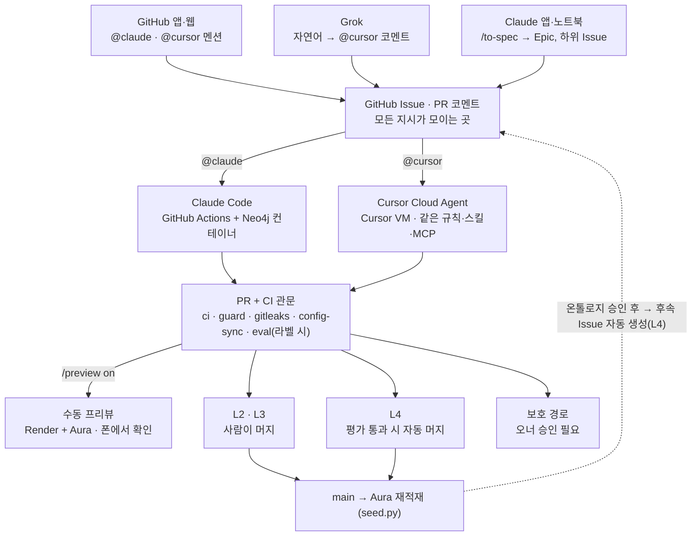

# Vibe Coding Software Factory — Action Plan v1.0

Nov 12, 2026 · @Sewook Kim

## 0. 문서 개요

**하루(근무일 1일, 약 8시간) 안에 코딩 에이전트 공장(Factory)을 세우고, 그 공장이 제품(Product)을 만들기 시작할 수 있는 상태로 만드는 것이 이 계획의 목표입니다.** 공장은 GitHub Issue 멘션으로 Claude Code와 Cursor에게 일을 시키고, 사람은 정해진 관문에서만 승인합니다. 제품은 자동차 파워트레인 결함 데이터로 그래프 검색을 하고 장애보고서·조치계획 초안을 쓰는 LangGraph/DeepAgents 앱입니다.

- **1차 목적**: 학습. Vibe Coding과 Harness Engineering을 직접 몸으로 익힘 (Q1-b)
- **범위 안**: Factory 셋업 전체, Product의 골격과 백로그, 첫 E2E 스모크 테스트
- **범위 밖(당분간)**: 메신저(Slack/Telegram) 연동, 팀 확장, 24시간 상주 서버, 유료 전환
- **읽는 법**: Runbook(5장)의 각 단계는 *명령 → 성공 조건(pass/fail) → 왜(한 줄)* 순서입니다. 성공 조건을 통과해야 다음 단계로 넘어갑니다.
- **표기**: `autonomy:L2` 같은 백틱 표기는 GitHub 라벨, `/preview on` 같은 표기는 Issue/PR 코멘트 명령입니다.

**개정 (2026-11-12).** Grok 계획서와 비교해 다섯 가지를 반영했습니다. 보호 경로 강제에 CODEOWNERS 필수 리뷰와 의존성·배포 설정 경로 추가(4장), 신고 데이터의 식별 열 제거와 리콜 파일 경로(7.1), CI에 pyright와 커버리지 하한(4.3), 프리뷰 배포 뒤 스모크(Phase 7), 토큰 만료 등 리스크(12장)입니다.

## 1. 확정된 결정사항

3라운드 질의응답으로 확정한 내용입니다. 이 표를 바꾸는 것은 ‘요구사항 정의’이므로 사람만 합니다.

| 영역 | 결정 | 근거 |
| --- | --- | --- |
| 목적 | 학습 우선. 하네스 자체가 결과물 | Q1 |
| Day-1 종료 상태 | “Issue N 구현해줘” 지시만으로 Product 개발이 굴러가는 상태 | Q2, Q3 |
| 최종 데모 | `@claude` → 구현·테스트·PR → `/preview on` → 모바일 웹에서 “변속기 과열” 검색 → 그래프+초안 표시 | Q2 |
| 자율성 | 라벨로 명시. L2(근무 중, 중요) / L3(출퇴근, 덜 중요) / L4(심야, 자동 머지) | Q4, Q17 |
| 사람 게이트 | 비용, 스키마·온톨로지, 인터페이스·자료구조, 시크릿, 요구사항(Epic) | Q5, C1 |
| 자동화 범위 | 온톨로지 변경(사람 승인) 이후의 적재·임베딩 코드 재설계·구현·배포는 완전 자동. L4도 온톨로지는 못 바꿈 | C1 |
| Epic→Issue | Epic은 사람이 Matt Pocock `/to-spec`으로 작성, 하위 Issue는 에이전트 자동 생성 허용 | Q18 |
| 데이터 | NHTSA 공개 데이터, 파워트레인, 신고 1,000건 샘플로 시작 | Q6, Q7, Q24 |
| 유사도 가설 | 원인(LLM 추출) > 부품 > 제조사 > 증상 | C2 |
| 출력 | Markdown 초안 | Q9 |
| 런타임 스택 | Python, LangGraph/DeepAgents, OpenRouter(`OPENROUTER_API_KEY` 환경변수) | Q14 |
| 그래프 DB | CI·L4 평가 = Actions의 Neo4j 컨테이너 / 프리뷰·main = Aura Free | C3, B2 |
| 프리뷰 | Render 무료 웹 서비스, 수동 on/off, URL만으로 접근 | C6, B2 |
| 지시 채널 | GitHub 멘션(`@claude`, `@cursor`) + Grok → GitHub → Cursor 통로 | Q11, C5, B1 |
| 에이전트 선택 | 호출한 멘션이 공급자를 결정. 두 에이전트는 같은 규칙·스킬·MCP를 봄 | Q13, Q28 |
| 리포 | 개인 계정 Public | Q16 |
| UI | Streamlit + 시각적 그래프 | Q27 |
| 비용 | 추가 지출은 OpenRouter만. 월 $20 상한(8장) | Q10, C4 |

## 2. 아키텍처

**모든 지시는 GitHub 한 곳으로 모이고, 실제 강제(승인·비용·보호 경로)는 에이전트가 아니라 CI가 합니다.** 에이전트 Hook은 빠른 피드백용 1차 방어선이고, 마지막 방어선은 GitHub Actions의 필수 체크입니다.

### 2.1 두 개의 층

- **Factory 층**: 코드를 만드는 체계. 지시 채널, 코딩 에이전트 2종, 공통 규칙·스킬·MCP, Hook, CI/평가, 프리뷰, 비용 가드.
- **Product 층**: 공장이 만드는 앱. NHTSA → 적재 → Neo4j(그래프+벡터) → LangGraph 검색·초안 → Streamlit UI.

### 2.2 지시 채널과 라우팅

| 지시 방법 | 실행 주체 | 실행 위치 | 인증 |
| --- | --- | --- | --- |
| Issue/PR 코멘트 `@claude ...` | Claude Code (`anthropics/claude-code-action`) | GitHub Actions 러너 | `CLAUDE_CODE_OAUTH_TOKEN` (구독) |
| Issue/PR 코멘트 `@cursor ...` | Cursor Cloud Agent | Cursor 클라우드 VM | Cursor–GitHub 연동 |
| Grok에 자연어 지시 → Grok이 GitHub에 `@cursor ...` 코멘트 | Cursor Cloud Agent | 위와 동일 | Grok의 GitHub 쓰기 권한 (12장 검증 V1) |
| `/preview on #PR` · `/preview off` 코멘트 | `preview.yml` 워크플로 | Actions → Render API + Aura | `RENDER_API_KEY`, `NEO4J_*` |
| `/to-spec` → `/to-tickets` | Claude Code 세션(노트북 또는 Claude 앱) | 로컬/클라우드 세션 | GitHub CLI 인증 |

같은 Issue에 두 에이전트가 호출되면 먼저 잡은 쪽이 `agent:claude` 또는 `agent:cursor` 라벨을 붙여 잠급니다. 한쪽이 구현한 PR은 다른 쪽이 리뷰합니다(교차 리뷰).

### 2.3 자율성 레벨

| 라벨 | 사용 상황 | 에이전트 허용 범위 | 머지 |
| --- | --- | --- | --- |
| `autonomy:L2` (기본값) | 근무 중, 중요 요구사항 | 지시된 Issue 구현 + 테스트 + PR | 사람이 리뷰 후 머지 |
| `autonomy:L3` | 출퇴근, 덜 중요 | Epic에 멘션 한 번 → 하위 Issue 전부 처리, 빠진 하위 Issue는 생성 | 사람이 모바일에서 최소 승인 |
| `autonomy:L4` | 심야 배치 | 테스트 보강, 리팩터링, 문서 동기화, 온톨로지 변경 후속 재구현 | 평가 관문 통과 시 자동 머지 |

모든 레벨에서 보호 경로(`ontology/`, `interfaces/`, `.github/workflows/`, eval/gold/, eval/baseline.json, 의존성·배포 설정, 시크릿 관련) 변경은 사람 승인 없이는, 즉 `approved:gate` 라벨 없이 머지되지 않습니다(4장).

**L3 실행 방식.** `autonomy:L3` 이상인 Epic에 `@claude` 또는 `@cursor`를 한 번 멘션하면, 에이전트가 그 Epic의 열린 하위 Issue를 의존 순서대로 모두 처리합니다. Issue마다 PR을 하나씩 만들고, 머지는 사람이 합니다. Epic의 수용 기준을 채우는 데 하위 Issue가 빠져 있으면 Epic 범위 안에서만 새로 만들고(`Parent: #N` 포함) 이어서 처리합니다. 보호 경로를 건드려야 하는 Issue는 건너뛰고 `needs-human`을 붙입니다. Epic 멘션은 제한 시간을 120분으로 둔 별도 job으로 돌리고, 시간이 다 되면 남은 Issue 목록을 코멘트로 남깁니다. 다시 멘션하면 이어서 합니다.

### 2.4 환경 맵

| 구성 요소 | 역할 | 비용 |
| --- | --- | --- |
| GitHub (Public 리포) | 지시 채널, 코드, Issue/라벨, 상태 기록 | 무료 |
| GitHub Actions | Claude 실행, CI, 평가, L4 배치, 프리뷰 제어, Aura keepalive | Public 리포 표준 러너 무료 |
| GitHub Codespaces | 사람의 작업대(노트북 터미널, 폰 브라우저). Neo4j 컨테이너 포함 | 월 무료 한도 내 (2-core, idle 30분) |
| Cursor Cloud Agent | `@cursor` 작업 실행 | 기존 구독 |
| Neo4j Aura Free | main 기준 그래프 + 현재 켜진 프리뷰의 무대 | 무료 (노드 20만/관계 40만) |
| Neo4j 컨테이너 | CI·L4 평가용 일회성 DB | 무료 |
| Render Free | 프리뷰 앱 서빙 (512MB, 15분 idle 시 spin down) | 무료 |
| OpenRouter | 런타임 LLM·임베딩·평가 | 유일한 추가 지출, 상한 8장 |



어느 경로로 지시해도 PR + CI 관문을 거치고, 온톨로지 승인 뒤에는 공장이 스스로 후속 Issue를 만들어 다시 돌아갑니다.

## 3. 리포지토리 구조와 에이전트 공통 설정

**규칙·스킬·MCP·Hook은 각각 원본을 하나만 두고, Claude와 Cursor는 그 원본을 참조하거나 생성물을 읽습니다.** 생성물과 원본이 어긋나면 CI가 실패합니다.

### 3.1 디렉터리 구조

```text
software-factory/
├── AGENTS.md                 # 규칙 원본 (두 에이전트 공통)
├── CLAUDE.md                 # "@AGENTS.md" import + Claude 전용 메모
├── CONTEXT.md                # 도메인 용어집 (Matt Pocock 스킬이 참조)
├── docs/adr/                 # 결정 기록 (ADR)
├── .agents/
│   ├── skills/               # 스킬 원본: matt-pocock, langchain-skills, 자체 스킬
│   ├── hooks/                # 공용 Hook 스크립트 (*.sh)
│   └── mcp.json              # MCP 원본
├── .claude/
│   ├── settings.json         # hooks → .agents/hooks/*.sh
│   └── skills -> ../.agents/skills
├── .cursor/
│   ├── mcp.json              # 생성물
│   ├── hooks.json            # → .agents/hooks/*.sh
│   ├── environment.json      # Cloud Agent 환경 정의
│   └── skills -> ../.agents/skills
├── .mcp.json                 # 생성물 (Claude용)
├── .devcontainer/            # devcontainer.json + docker-compose (app + neo4j)
├── .github/
│   ├── workflows/            # claude, ci, guard, eval, nightly-l4, preview,
│   │                         # ontology-changed, aura-keepalive
│   ├── CODEOWNERS
│   └── ISSUE_TEMPLATE/
├── ontology/ontology.yaml    # [보호] 온톨로지 = 그래프 스키마
├── interfaces/               # [보호] 공개 자료구조(Pydantic), 모듈 간 계약
├── src/factory_app/
│   ├── ingest/  graph/  retrieval/  agent/  report/  ui/
│   ├── budget.py             # 비용 가드
│   └── config.py             # 모든 키·모델 ID는 환경변수
├── data/sample/              # 샘플 CSV + README(출처·라이선스)
├── eval/                     # gold/v1.jsonl, baseline.json, rubric.md, run_eval.py
├── scripts/                  # sync-agent-config.sh, sample_nhtsa.py, seed.py
├── render.yaml
└── pyproject.toml            # uv, ruff, pyright, pytest(cov)
```

### 3.2 단일 원본(single source of truth) 매핑

| 대상 | 원본 | Claude가 읽는 곳 | Cursor가 읽는 곳 | 동기화 |
| --- | --- | --- | --- | --- |
| 규칙 | `AGENTS.md` | `CLAUDE.md`의 `@AGENTS.md` import | `AGENTS.md` 직접 | 불필요 |
| 스킬 | `.agents/skills/` | `.claude/skills` (symlink) | `.cursor/skills` (symlink) | symlink, 미지원 시 복사 (검증 V3) |
| MCP | `.agents/mcp.json` | `.mcp.json` | `.cursor/mcp.json` | `scripts/sync-agent-config.sh` 생성, CI에서 `--check` |
| Hook | `.agents/hooks/*.sh` | `.claude/settings.json` | `.cursor/hooks.json` | 스크립트는 공유, 등록만 각자 |

### 3.3 기본 탑재 MCP

| MCP | 용도 | 연결 대상 |
| --- | --- | --- |
| GitHub | Issue·PR·라벨 조작 | GitHub 원격 MCP |
| Neo4j Cypher | 스키마 조회, 쿼리 실험 | 기본은 로컬/CI 컨테이너. Aura는 스크립트로만 쓰기 |
| Context7 | 라이브러리 최신 문서(보조) | 호스팅 |
| LangChain Docs | LangChain·LangGraph·DeepAgents 가이드 | `https://docs.langchain.com/mcp` |
| LangChain Reference | API 레퍼런스 | `https://reference.langchain.com/mcp` |

### 3.4 기본 탑재 스킬

- **Matt Pocock (`mattpocock/skills`)**: `setup-matt-pocock-skills`, `to-spec`, `to-tickets`, `triage`, `tdd`, `grill-me`, `handoff` 등. 설치 후 한 번 `setup-matt-pocock-skills`로 tracker(GitHub)와 triage 라벨 어휘를 구성
- **LangChain (`langchain-ai/langchain-skills`)**: `ecosystem-primer`를 먼저, 이후 LangGraph·DeepAgents 관련 스킬
- **자체 스킬**: `reindex-graph`(온톨로지 → 적재 → 임베딩 → 평가), `run-eval`, `write-8d-draft`(초안 템플릿 규칙), `preview`(on/off 절차)
- 자체 `triage-issue`는 Matt Pocock의 `triage`와 겹치므로 만들지 않음

## 4. 라벨 체계와 사람 게이트 강제

**사람 게이트 5개는 모두 ‘오너만 붙일 수 있는 라벨 + 필수 CI 체크’로 강제합니다.** 혼자 쓰는 리포라 ‘승인 리뷰 필수’는 켜지 않고, L2·L3의 승인은 머지 버튼을 누르는 행위입니다.

**강제 수단은 Phase 3.4의 테스트(검증 V11)로 둘 중 하나를 고릅니다.** 에이전트가 여는 PR의 작성자가 봇 계정이면 GitHub 기본 기능인 **CODEOWNERS 필수 리뷰**를 씁니다. 워크플로를 고쳐서 우회할 수 없고 만들 것도 없어서 이쪽이 우선입니다. 이 경우 `guard.yml`과 `approved:gate`는 만들지 않고, 아래에서 “라벨을 붙인다”는 “승인 리뷰를 남긴다”로 읽습니다. 반대로 PR이 내 계정 명의로 열리면 GitHub가 본인 PR의 승인을 허용하지 않으므로, 아래의 **guard + `approved:gate` 라벨** 방식을 씁니다.

보호 경로는 두 등급입니다.

| 등급 | 경로 | 에이전트 | 머지 |
| --- | --- | --- | --- |
| 수정 금지 | `ontology/`, `interfaces/`, `eval/gold/`, `eval/baseline.json`, `.github/**` | 고치지 않고 PR 설명에 제안만 남김 | 사람이 직접 바꾸거나 승인 |
| 승인 필요 | `pyproject.toml`, `uv.lock`, `render.yaml`, `.devcontainer/**`, 인증·시크릿을 다루는 코드 | 고칠 수 있음 | 사람 승인 후 머지, L4 자동 머지 제외 |

### 4.1 라벨

| 라벨 | 의미 | 붙이는 주체 |
| --- | --- | --- |
| `autonomy:L2` / `L3` / `L4` | 자율성 레벨. 없으면 L2로 간주 | 사람 |
| `agent:claude` / `agent:cursor` | 작업 잠금 (먼저 잡은 쪽) | 에이전트 |
| `approved:gate` | 보호 경로 변경 승인 | 오너만 (guard가 붙인 사람을 확인) |
| `eval` | 유료 평가 실행 요청 | 오너 |
| `ontology-followup` | 온톨로지 변경 후속 재구현 Issue (자동 생성) | 워크플로 |
| `budget:exceeded` | 비용 상한 초과로 멈춤 | 워크플로 |
| `preview:on` | 현재 프리뷰 중인 PR (한 번에 1개) | 워크플로 |
| Matt Pocock triage 라벨 | `setup-matt-pocock-skills`가 만드는 어휘 그대로 사용 | 스킬 |

### 4.2 게이트별 강제 방식

| 게이트 | 1차 방어 (에이전트 Hook) | 최종 강제 (CI·GitHub) |
| --- | --- | --- |
| 스키마·온톨로지 | `ontology/` 수정 시 경고·차단 | `guard.yml`: 보호 경로 diff가 있으면 오너의 `approved:gate` 없이 실패 |
| 인터페이스·자료구조 | `interfaces/` 수정 차단 | 같은 guard + Pydantic JSON 스키마 스냅샷 테스트 (디렉터리 밖에서 바꿔도 감지) |
| 시크릿 | 커밋 전 gitleaks, `.env` 편집 차단 | CI gitleaks + GitHub secret scanning·push protection |
| 비용 | 유료 호출 명령 차단(로컬) | `budget.py` 소프트 상한 + OpenRouter 키 한도(하드) + `eval` 라벨 관문 |
| 요구사항 | Epic 생성은 스킬 절차로만 | 에이전트가 만든 Issue는 오너가 쓴 Epic을 `Parent: #N`으로 참조해야 함. 없으면 `needs-human` |

관문이 뚫리지 않게 하는 규칙 세 가지입니다.

- **guard는 `pull_request_target`으로 실행**합니다. `pull_request`는 PR 쪽 워크플로 파일로 돌기 때문에, PR이 `guard.yml`을 고치면 관문이 무력화됩니다. guard는 PR 코드를 체크아웃하지 않고 API로 변경 파일 목록과 라벨 이벤트만 봅니다.
- **`eval/baseline.json`도 보호 경로**입니다. 에이전트가 baseline을 낮춰 L4 관문을 통과하지 못하게, 머지 후 main에서 워크플로만 갱신합니다.
- **오너 계정으로 행동하는 도구는 승인 라벨을 붙이지 못하게** 합니다. Grok과 로컬 Claude는 내 계정으로 동작하므로 guard가 구분할 수 없습니다. Grok의 GitHub 권한은 코멘트 작성까지만 주고, `cost_guard.sh`와 같은 방식의 Hook으로 `approved:gate`를 붙이는 명령을 막습니다. 이 라벨은 사람이 GitHub 화면에서만 붙입니다.

### 4.3 main 브랜치 보호 설정

- PR 필수, force push·삭제 금지
- 필수 체크: `ci`, `guard`, `config-sync`, `gitleaks`
- 승인 리뷰 수: 0 (솔로 운영)
- 리포 설정 “Allow auto-merge” 켜기 (L4 자동 머지용)
- `CODEOWNERS`로 보호 경로의 소유자 표시

`ci`가 확인하는 것은 `ruff check`, `ruff format --check`, `pyright`, `pytest`(LLM은 mock, 커버리지 하한 80%)입니다. 하한은 첫 주 실측을 보고 조정합니다. 포크에서 온 PR의 CI에는 시크릿을 주지 않고, Secret scanning과 Push protection을 켭니다. CODEOWNERS 방식을 고른 경우 “Require review from Code Owners”를 켜고 필수 체크에서 `guard`를 뺍니다.

## 5. Day-1 셋업 Runbook

**9개 Phase, 합계 약 7시간 15분 + 버퍼 45분입니다.** Phase 0\~5는 노트북에서 연속으로, Phase 6은 폰으로도 가능합니다. 골격 코드는 직접 치지 않고 로컬 Claude Code에게 이 문서를 주고 만들게 합니다. 공장을 만드는 것 자체가 첫 Vibe Coding 연습입니다.

| Phase | 내용 | 시간 | 기기 |
| --- | --- | --- | --- |
| 0 | 계정·키·시크릿 | 30분 | 노트북 |
| 1 | 리포 골격 + devcontainer + Codespaces | 60분 | 노트북 |
| 2 | 공통 규칙·스킬·MCP | 60분 | 노트북 |
| 3 | Hook과 가드(CI 강제) | 45분 | 노트북 |
| 4 | 코딩 에이전트 연결 | 60분 | 노트북 + 폰 |
| 5 | CI·평가·심야 배치·비용 | 60분 | 노트북 |
| 6 | Epic 작성과 백로그 생성 | 45분 | 노트북 또는 폰 |
| 7 | 수동 프리뷰(Render) | 45분 | 노트북 |
| 8 | E2E 스모크 테스트 | 30분 | 폰 |

### Phase 0. 계정·키·시크릿 (30분)

| 단계 | 할 일 | 성공 조건 | 왜 |
| --- | --- | --- | --- |
| 0.1 | `gh repo create software-factory --public --add-readme` | 리포 생성, main 존재 | Public이면 Actions 표준 러너가 무료 |
| 0.2 | Aura Free 인스턴스 생성, URI/사용자/비밀번호 저장 | Aura 콘솔에서 `RETURN 1` 성공 | main 기준 그래프와 프리뷰의 무대 |
| 0.3 | OpenRouter 키 2개 발급: `runtime`(한도 $10), `eval`(한도 $10) | 키별 한도가 콘솔에 표시 (검증 V5) | 월 $20 하드 상한을 키에 걸어 둔다 |
| 0.4 | Render 가입 → GitHub 연결 → API 키 발급 | API 키 보관 | Phase 7에서 워크플로가 on/off |
| 0.5 | 로컬에서 `claude setup-token` | 구독 기반 OAuth 토큰 획득 | Actions 안의 Claude가 구독으로 돈다 |
| 0.6 | `gh secret set`으로 부록 A의 시크릿 일괄 등록 | `gh secret list`에 전부 표시 | 키는 코드에 없고 런타임 환경변수로만 |

### Phase 1. 리포 골격 + devcontainer + Codespaces (60분)

| 단계 | 할 일 | 성공 조건 | 왜 |
| --- | --- | --- | --- |
| 1.1 | 로컬 Claude Code에 이 문서 3장·부록 B를 주고 “이 구조로 골격과 AGENTS.md를 만들어” 지시 | 3.1의 트리와 일치, `uv run pytest` 통과(빈 테스트 1개) | 공장 자체도 Vibe Coding으로 만든다 |
| 1.2 | `.devcontainer`: Python 3.12 + uv + docker-compose(neo4j:5 community, 7474/7687), 포트 8501 포워딩 | 컨테이너 안에서 `cypher-shell 'RETURN 1'` 성공 | 누가 열어도 같은 환경 (팀 확장 대비) |
| 1.3 | Codespace 생성 (2-core, idle timeout 30분) | 폰 브라우저로 Codespace 접속 후 터미널에서 `uv run pytest` | 폰에서도 쓸 수 있는 사람의 작업대 |
| 1.4 | Streamlit hello 페이지 + `config.py`(모든 값 환경변수) | Codespace 포트 8501을 폰에서 열었을 때 페이지 표시 | Phase 7·8의 기반 |

### Phase 2. 공통 규칙·스킬·MCP (60분)

| 단계 | 할 일 | 성공 조건 | 왜 |
| --- | --- | --- | --- |
| 2.1 | `npx skills add mattpocock/skills`, `npx skills add langchain-ai/langchain-skills` → `.agents/skills/` | 두 묶음이 `.agents/skills/` 아래 존재 | 두 에이전트가 같은 원본을 본다 |
| 2.2 | `.claude/skills`, `.cursor/skills` symlink | Claude·Cursor 모두 “쓸 수 있는 스킬 목록”에 같은 이름 | 어느 쪽을 불러도 같은 품질 |
| 2.3 | Claude Code에서 `/setup-matt-pocock-skills` (tracker=GitHub) | triage 라벨이 리포에 생성, 설정 커밋 | `/to-spec` 선행 조건 |
| 2.4 | `.agents/mcp.json` 작성 + `scripts/sync-agent-config.sh` | `.mcp.json`과 `.cursor/mcp.json`이 생성되고 `--check`가 0 반환 | MCP 설정의 드리프트 방지 |
| 2.5 | 자체 스킬 4개 뼈대(`reindex-graph`, `run-eval`, `write-8d-draft`, `preview`) | 각 SKILL.md에 트리거·절차·성공 조건 | 반복 작업을 절차로 고정 |
| 2.6 | 교차 검증: 두 에이전트에 “LangChain Docs MCP로 DeepAgents의 subagent 생성 API 찾아줘” | 둘 다 MCP를 호출해 출처와 함께 답함 | LLM이 최신 API를 모르는 문제 해결 |

### Phase 3. Hook과 가드 (45분)

| 단계 | 할 일 | 성공 조건 | 왜 |
| --- | --- | --- | --- |
| 3.1 | `.agents/hooks/`: `protect_paths.sh`, `block_secrets.sh`, `fast_checks.sh`(ruff+단위 테스트), `cost_guard.sh` | 각 스크립트를 수동 실행해 차단 시 exit 2 | 에이전트가 실수하기 전에 멈춘다 |
| 3.2 | `.claude/settings.json`(PreToolUse/Stop), `.cursor/hooks.json`에 등록 | Claude·Cursor 각각에게 `ontology/ontology.yaml` 수정을 시켜서 차단됨 (검증 V9) | 훅은 공유, 등록만 따로 |
| 3.3 | pre-commit + gitleaks | 가짜 키 문자열 커밋 시도가 실패 | 시크릿 게이트 |
| 3.4 | `ci.yml`, `guard.yml`, `config-sync.yml`, `gitleaks.yml` + `gh api`로 브랜치 보호(4.3) | 온톨로지를 건드린 테스트 PR이 `guard` 실패 → 오너가 `approved:gate` 붙이면 통과. 먼저 검증 V11로 CODEOWNERS 필수 리뷰를 쓸 수 있는지 확인 | Hook은 우회 가능, CI는 우회 불가 |

### Phase 4. 코딩 에이전트 연결 (60분)

| 단계 | 할 일 | 성공 조건 | 왜 |
| --- | --- | --- | --- |
| 4.1 | Claude Code에서 `/install-github-app` → `claude.yml`(`anthropics/claude-code-action`, OAuth 토큰, Neo4j 서비스 컨테이너, 리포 MCP 설정 사용) | Issue에 `@claude 안녕, 스킬 목록 말해줘` → 코멘트 답변 (검증 V2, V8) | `@claude` 경로 개통. 통합 테스트까지 에이전트가 직접 실행 |
| 4.2 | Cursor 대시보드에서 GitHub 연결 + Cloud Agent 시크릿 등록 + `.cursor/environment.json`(uv 설치, 의존성) | Issue에 `@cursor` 멘션 → 반응(이모지/코멘트) (검증 V4) | `@cursor` 경로 개통 |
| 4.3 | Grok의 GitHub 연동 켜기 → “Issue #1에 `@cursor README에 배지 추가` 코멘트 남겨” | 코멘트가 내 계정 명의로 달리고 Cursor가 반응 (검증 V1) | 폰에서 자연어로 Cursor 지시 |
| 4.4 | Issue 템플릿: 목표, 수용 기준, `Parent: #N`, 자율성 레벨 체크박스 | 새 Issue 화면에 템플릿 표시 | 에이전트 입력의 품질을 고정 |
| 4.5 | 교차 스모크: 작은 Issue 두 개를 각각 `@claude`, `@cursor`에게 | 두 PR 모두 CI 통과, 상대방이 리뷰 코멘트 (검증 V10도 여기서) | 두 공급자가 같은 규칙으로 일한다는 증명 |

### Phase 5. CI·평가·심야 배치·비용 (60분)

| 단계 | 할 일 | 성공 조건 | 왜 |
| --- | --- | --- | --- |
| 5.1 | `budget.py`: 호출별 비용 누적 + 실행 전 잔액 확인, 상한 초과 시 예외 | 상한을 $0.01로 두고 호출 시 멈춤 | 소프트 상한 (하드는 키 한도) |
| 5.2 | `eval.yml`: PR에 `eval` 라벨 → Neo4j 컨테이너 → 시드 → `run_eval.py` → baseline 비교 → PR 코멘트 | 더미 평가셋으로 표가 코멘트로 달림 | L4 자동 머지의 관문 |
| 5.3 | `nightly-l4.yml`: 매일 01:17 KST + 수동 실행. `autonomy:L4` 큐가 비면 즉시 종료 | 빈 큐로 수동 실행 시 1분 안에 정상 종료 | 매일 안 돌리더라도 큐가 있는 날만 자동 실행 |
| 5.4 | L4 자동 머지 조건 스크립트: 평가 ≥ baseline, 보호 경로 diff 없음, 비용 이내 → `gh pr merge --auto --squash` | 조건을 하나 깨뜨린 테스트 PR이 머지되지 않음 | 자동은 관문을 통과한 것만 |
| 5.5 | 아침 요약: 고정 Issue “Night Shift Log”에 코멘트(머지된 PR, 점수 변화, 비용, 승인 대기) | 수동 실행 후 코멘트 1개 생성 | 폰에서 한눈에 확인 |
| 5.6 | `ontology-changed.yml`(9장), `aura-keepalive.yml`(매일 1회 `RETURN 1`) | keepalive 수동 실행 성공 | Aura는 3일 무활동 시 일시정지, 30일이면 삭제 |

시간이 모자라면 5.3\~5.5와 `ontology-changed.yml`은 다음 날로 미뤄도 됩니다. Day-1 목표(“Issue N 구현해줘”가 되는 상태)에는 5.1, 5.2, keepalive만 필요하고, 수용 기준 중 심야 배치 항목만 늦어집니다. 5.4의 자동 머지 뒤 후속 작업(Aura 재적재, 후속 Issue 생성)은 `workflow_dispatch`로 직접 호출합니다. 기본 토큰이 한 머지는 다른 워크플로를 깨우지 않기 때문입니다.

### Phase 6. Epic 작성과 백로그 생성 (45분)

| 단계 | 할 일 | 성공 조건 | 왜 |
| --- | --- | --- | --- |
| 6.1 | Claude Code에 이 문서 7장을 주고 대화로 다듬은 뒤 `/to-spec` (Epic별 1회) | Epic 3개가 내 계정 명의 Issue로 게시 | 요구사항 정의는 사람의 게이트 |
| 6.2 | 각 Epic에 `/to-tickets` | 하위 Issue 약 10개, 모두 `Parent: #N`과 수용 기준 포함 | Day-1 종료 상태 = 지시만 하면 되는 백로그 |
| 6.3 | Epic과 하위 Issue에 자율성 라벨 부여 (11장 제안) | 라벨 없는 Issue 0개 | 레벨은 사람이 명시 |

### Phase 7. 수동 프리뷰 (45분)

| 단계 | 할 일 | 성공 조건 | 왜 |
| --- | --- | --- | --- |
| 7.1 | `render.yaml`: 무료 웹 서비스, `streamlit run ... --server.port $PORT --server.address 0.0.0.0`, auto-deploy 끔 → Blueprint로 생성 | Render URL에서 hello 페이지 | 프리뷰는 지시할 때만 |
| 7.2 | `preview.yml` — `/preview on` (PR, 오너만): 서비스 브랜치 변경 → 배포 → 그 브랜치의 `seed.py --target aura` → URL 코멘트 + `preview:on` | 폰에서 URL 접속, 브랜치 내용 표시 (검증 V7) | 브랜치별 확인 (C3·B2) |
| 7.3 | `/preview off`: 서비스 suspend → main 기준으로 Aura 재적재 → 라벨 제거 | URL이 정지 상태, Aura가 main 데이터 | Aura를 깨끗하게 되돌린다 |
| 7.4 | 다른 PR이 `preview:on`인데 `/preview on` 하면 거절 | 거절 코멘트 | 프리뷰는 한 번에 하나 |

`/preview on`은 배포 뒤 스모크를 통과해야 URL을 코멘트합니다. `scripts/smoke.py`가 콜드 스타트를 감안해 최대 180초 동안 앱의 헬스 응답을 기다리고, Aura에서 노드 수를 조회해 적재가 끝났는지 확인합니다. 실패하면 서비스를 suspend하고 Aura를 main 기준으로 되돌린 뒤 실패 원인을 코멘트합니다. Render는 15분 동안 요청이 없으면 잠들고 다시 켜지는 데 1분주 걸립니다.

### Phase 8. E2E 스모크 테스트 (30분, 폰)

1. 폰 GitHub 앱에서 Issue 생성: “Streamlit에 Aura 노드 개수를 보여주는 Graph Status 페이지”, `autonomy:L2`
2. `@claude 이 Issue 구현하고 테스트 통과시켜서 PR 올려줘`
3. PR의 CI가 초록이면 PR에 `/preview on`
4. 폰 브라우저로 URL 접속(첫 접속 약 1분 대기) → 페이지 확인
5. 머지 → `/preview off`
6. 같은 절차를 Grok → `@cursor` 경로로 한 번 더

## 6. Day-1 수용 기준

아래 10개가 모두 체크되면 Factory 셋업이 끝난 것입니다. 하나라도 남으면 그 Phase로 돌아갑니다.

- [ ] 폰에서 Codespace 터미널로 `uv run pytest`가 통과한다
- [ ] Claude와 Cursor가 같은 스킬 목록과 같은 MCP 5개를 본다
- [ ] `ontology/`를 건드린 PR은 `approved:gate` 없이 머지되지 않는다
- [ ] 가짜 키 커밋이 로컬과 CI 모두에서 막힌다
- [ ] `@claude`와 `@cursor` 각각이 Issue에서 PR을 만들고 CI를 통과한다
- [ ] Grok으로 내린 지시가 GitHub 코멘트를 거쳐 Cursor PR까지 이어진다
- [ ] `/preview on`으로 폰에서 브랜치를 보고, `/preview off`로 끄고 Aura가 main으로 돌아온다
- [ ] 빈 큐로 심야 배치를 수동 실행하면 정상 종료하고 Night Shift Log에 코멘트가 남는다
- [ ] 비용 가드가 낮은 상한에서 실제로 호출을 멈춘다
- [ ] Epic 3개와 라벨이 붙은 하위 Issue가 있고, “@claude Issue #N 구현해줘” 한 마디로 Product 개발을 시작할 수 있다

## 7. Product 설계 기본안

**소비자 결함 신고를 ‘장애보고서’로, 리콜의 결함·조치 내용을 ‘조치보고서’로 보고, LLM이 추출한 원인을 중심으로 유사 사례를 찾습니다.** 이 장은 Phase 6에서 `/to-spec`에 넣을 입력입니다. 온톨로지와 인터페이스는 보호 대상이라, v1 확정은 최초 PR에서 사람이 승인합니다.

### 7.1 데이터

| 항목 | 기본안 |
| --- | --- |
| 원천 | NHTSA ODI Complaints flat file, Recalls flat file(FLAT\_RCL\_PRE\_2010.zip, FLAT\_RCL\_POST\_2010.zip) (공공 데이터). TSB(Manufacturer Communications)는 2단계 |
| 매핑 | 신고 = 장애보고서, 리콜 결함 요약·조치(remedy) = 조치보고서 |
| 필터 | 부품 분류가 파워트레인·엔진 계열, 최근 5년 |
| 샘플 | 신고 1,000건 (난수 시드 고정) + 같은 차종·연식·부품에 걸린 리콜 |
| 보관 | `data/sample/*.csv` 커밋 + `data/README.md`(출처, 다운로드 날짜, 필터 조건) |
| 확장 | 1,000 → 5,000 → 전체 파워트레인. 크기 변경은 Issue 하나 |

Public 리포에 올리는 데이터이므로 세 가지를 지킵니다.

- **식별 열은 버립니다.** 신고 파일에서는 ODI 번호, 날짜, 제조사·모델·연식, 부품 분류, 서술문만 남기고 VIN 일부, 판매점, 지역 같은 나머지 열은 샘플링 단계에서 제거합니다. 어떤 열이 있는지는 파일 레이아웃 문서(CMPL.txt)로 확인합니다(검증 V6).
- **원본 zip은 커밋하지 않습니다.** `data/raw/`를 `.gitignore`에 넣고, 정제한 샘플만 `data/sample/`에 둡니다.
- **리콜 파일은 PRE/POST 2010 두 개를 받습니다.** 옛 단일 파일 FLAT\_RCL.zip은 Grok 측 조사에서 404였습니다. `README`와 `NOTICE`에 출처와 “제작사 내부 보고서가 아니라 공개 규제 데이터”임을 적습니다.

### 7.2 온톨로지 v1 (`ontology/ontology.yaml`, 보호)

| 노드 | 주요 속성 | 출처 |
| --- | --- | --- |
| `Complaint` | odi\_id, 날짜, 서술 원문, embedding | 신고 파일 |
| `Recall` | campaign\_no, 결함 요약, 결과, 조치, embedding | 리콜 파일 |
| `Component` | 부품 분류명 | 두 파일 |
| `Vehicle` | 제조사, 모델, 연식 | 두 파일 |
| `Manufacturer` | 이름 | 두 파일 |
| `Cause` | 정규화된 원인 범주 | LLM 추출 |
| `Symptom` | 정규화된 증상 범주 | LLM 추출 |

관계: `(Complaint)-[:INVOLVES]->(Component)`, `(Complaint)-[:ABOUT]->(Vehicle)`, `(Vehicle)-[:MADE_BY]->(Manufacturer)`, `(Recall)-[:AFFECTS]->(Component)`, `(Recall)-[:COVERS]->(Vehicle)`, `(Complaint|Recall)-[:HAS_CAUSE]->(Cause)`, `(Complaint)-[:EXHIBITS]->(Symptom)`.

원인·증상 추출은 적재 시 1회 실행하고 결과를 `data/derived/`에 캐시합니다. 범주 목록(어휘)은 온톨로지에 포함되므로 바꾸려면 승인이 필요합니다.

LLM이 추출한 `Cause`·`Symptom` 노드와 그 관계에는 `derived=true` 속성을 달아 원본 데이터와 구분합니다. 초안과 UI에서도 추출값임을 표시합니다.

### 7.3 검색·초안 파이프라인 (LangGraph)

1. **parse**: 입력(“변속기 과열”)에서 부품·증상·추정 원인 후보를 구조화. 한국어 입력은 영어 검색어로도 변환
2. **vector\_search**: Neo4j 벡터 인덱스에서 후보 Complaint·Recall 50개
3. **graph\_expand**: 후보를 원인 → 부품 → 제조사 → 증상 순서로 확장하며 공유 경로 점수화
4. **rerank**: `점수 = α·벡터 + Σ wᵢ·공유여부`. 초기 가중치 원인 0.4, 부품 0.3, 제조사 0.15, 증상 0.15. 가중치는 `config`에 두어 L4가 튜닝 가능
5. **draft**: 상위 5건과 근거 경로로 Markdown 초안 작성
6. **cite\_check**: 초안의 모든 사례 언급이 실제 odi\_id·campaign\_no인지 검사. 없는 ID가 있으면 재생성

### 7.4 초안 템플릿 (8D 약식)

- **장애보고서**: 현상, 영향 범위(차종·부품), 추정 원인, 유사 사례 상위 5건(근거 경로 포함)
- **조치계획**: 임시 조치, 근본 원인 조사 항목, 영구 조치 후보(유사 리콜의 remedy에서), 효과 검증 방법
- 모든 사례는 원본 ID를 달고, 추정은 “추정”이라고 표시

### 7.5 UI (Streamlit, 모바일 우선)

입력창 하나와 탭 3개: **유사 사례**(표, 점수·공유 노드) · **그래프**(입력 → 사례 → 원인/부품 노드를 색으로 구분한 시각화, `streamlit-agraph` 또는 pyvis) · **초안**(Markdown 렌더 + 다운로드). 상단에 이번 요청의 비용과 모델 ID를 표시합니다.

## 8. 평가와 비용 정책

**L4 자동 머지는 ‘고정된 정답셋에서 점수가 떨어지지 않고, 비용 상한 안에서’만 일어납니다.** 정답셋은 LLM이 만들지만, 만드는 모델·답하는 모델·채점하는 모델을 분리해 점수 부풀림을 막습니다.

### 8.1 정답셋 (`eval/gold/v1.jsonl`)

1. 상위 모델(`MODEL_LABELER`)이 샘플에서 서로 다른 원인·부품을 고루 갖춘 시드 신고 30건을 고른다
2. 각 시드마다 공장 엔지니어가 쓸 법한 짧은 질의(한국어 20, 영어 10)와 유사 사례 정답 목록(등급 2/1/0)을 만든다
3. 사람이 5개를 펼쳐 상식 점검(약 10분) → v1로 커밋하고 동결
4. 정답셋 변경은 `eval/gold/` 보호 경로 → 사람 승인

### 8.2 지표와 관문

| 지표 | 대상 | L4 관문 |
| --- | --- | --- |
| Recall@5 | 검색 | baseline − 0.02 이상 |
| nDCG@5 | 검색 | baseline − 0.02 이상 |
| 인용 유효성 | 초안 | 100% (존재하지 않는 ID 0개) |
| 루브릭 평균 (1\~5) | 초안 (`MODEL_JUDGE`) | baseline − 0.2 이상 |

에이전트는 baseline을 고치지 못합니다(보호 경로). 머지 후 main에서 워크플로만 `eval/baseline.json`을 갱신합니다. 모델 ID는 `MODEL_RUNTIME`, `MODEL_EMBED`, `MODEL_LABELER`, `MODEL_JUDGE` 환경변수로만 받고, 세 역할은 서로 다른 모델 계열로 둡니다.

위 허용 오차는 잠정값입니다. 정답셋 v1이 생기면 같은 코드로 평가를 3회 돌려 지표별 편차를 재고, 허용 오차를 그 편차의 2배로 다시 정합니다. 런타임과 채점 모델은 temperature 0으로 고정합니다.

### 8.3 비용 상한

| 구분 | 상한 | 초과 시 |
| --- | --- | --- |
| PR CI | $0 (LLM mock) | — |
| `eval` 평가 1회 (30개) | $0.50 | 중단, 승인 대기 |
| L4 심야 배치 1회 | $2 | 남은 작업 보류 |
| 하루 / 한 달 | $3 / $20 | `budget:exceeded`, 키 차단 |
| 1회성: 정답셋 생성, 원인·증상 추출 | 각 $2 | 실행 전 사람 승인 |

두 겹으로 걸립니다. `budget.py`가 먼저 멈추고(소프트), OpenRouter 키 한도가 마지막으로 막습니다(하드). 위 수치는 추정치이며, 첫 평가 3회의 실측값으로 다시 맞춥니다.

Actions 실행은 서로 기억을 공유하지 않으므로, 하루·월 누계는 `budget.py`가 실행 시작 때 OpenRouter 키 사용량을 조회해서 확인합니다(검증 V5). 조회가 안 되면 선불 잔액을 월 $20 이하로 유지하는 것이 유일한 상한이 됩니다.

## 9. 자동 재구축 파이프라인

**사람은 `ontology.yaml` 한 파일만 승인하고, 그 뒤의 적재·인덱스·임베딩·검색 코드 재구현과 배포는 공장이 혼자 합니다.** 이것이 이 프로젝트가 Software Factory인 이유입니다.

1. **사람**: 온톨로지 변경 PR (버전 올림 + `ontology/CHANGELOG.md`). 초안은 에이전트에게 맡겨도 됨
2. **guard**: `approved:gate` 없으면 머지 불가 → 사람이 라벨을 붙이고 머지
3. **`ontology-changed.yml`**: main에 `ontology/` 변경이 들어오면 후속 Issue를 자동 생성 (`ontology-followup`, `autonomy:L4`, `agent:claude`). 본문에 diff와 체크리스트(적재 매핑, 제약·인덱스, Cypher, 임베딩 대상, 재순위 가중치 매핑, 테스트)
4. **심야 L4**: 에이전트가 `reindex-graph` 스킬로 구현 → 컨테이너 DB에 재적재 → 평가
5. **관문 통과**: 자동 머지 + baseline 갱신. **실패**: PR 유지, `needs-human`, Night Shift Log에 원인 요약
6. **Aura 반영**: main 머지 후 `seed.py --target aura --rebuild`. 단, `preview:on`인 PR이 있으면 프리뷰를 끌 때까지 미룸

설계 원칙 세 가지를 `AGENTS.md`에 명시합니다.

- **선언형 우선**: 적재기는 `ontology.yaml`의 매핑을 읽어 동작하게 만들어, 온톨로지 변경 시 고칠 코드를 최소화한다
- **임베딩 캐시**: `(모델 ID, 임베딩 설정, 텍스트)` 해시를 키로 캐시해서, 바뀐 대상만 다시 임베딩한다
- **재현 가능성**: 어느 커밋에서든 `seed.py` 한 번으로 같은 그래프를 다시 만들 수 있어야 한다 (Aura가 삭제돼도 복구)

실행 조건 두 가지를 덧붙입니다.

- **캐시는 리포에 커밋**합니다. 원인·증상 추출 결과와 임베딩을 `data/derived/`에 두어, CI와 `/preview on`의 재적재가 LLM을 다시 호출하지 않게 합니다. CI 통합 테스트는 그중 50건짜리 고정 fixture만 씁니다. 그래야 PR CI 비용 $0이 지켜집니다.
- **후속 단계는 `workflow_dispatch`로 호출**합니다. 3번의 후속 Issue 생성과 6번의 Aura 반영은 L4 자동 머지 뒤에는 push 이벤트로 시작되지 않으므로, 머지한 job이 직접 호출합니다. 사람이 머지한 경우에는 push 이벤트로 시작됩니다.

## 10. 운영 리듬

**하루는 ‘낮에 지시·승인, 밤에 공장 가동, 아침에 결과 확인’으로 돌아갑니다.** 어떤 에이전트를 부를지는 항상 멘션으로 직접 정합니다.

| 시간대 | 기기·채널 | 레벨 | 사람이 하는 일 |
| --- | --- | --- | --- |
| 아침 | 폰, GitHub 앱 | — | Night Shift Log 확인, `needs-human` PR 처리 |
| 근무 중 틈틈이 | 노트북·폰, `@claude` / `@cursor` | L2 | 중요 Issue 지시, PR 리뷰·머지, `approved:gate` 판단 |
| 출퇴근 | 폰, Grok → `@cursor`, Claude 앱(`/to-spec`) | L3 | Epic 작성, Epic에 멘션 한 번, `/preview on`으로 확인 후 머지 |
| 심야 | 없음 (자동) | L4 | 자기 전 L4 큐에 라벨 붙이기만 |
| 주 1회 | 노트북 | — | 비용 실측 검토, 상한·baseline 조정, 유사도 가설 다시 보기 |

에이전트 선택 요령(권장일 뿐, 결정은 멘션): 여러 파일에 걸친 설계형 작업과 Neo4j 통합 테스트가 필요한 작업은 `@claude`(Actions에 DB 컨테이너가 붙음), UI·작은 수정과 폰에서 들어오는 일은 `@cursor`.

## 11. 초기 백로그

**Epic 3개, 하위 Issue 12개를 제안합니다.** Phase 6에서 `/to-spec`·`/to-tickets`가 실제 Issue를 만들며, 아래는 그 입력이자 검토 기준입니다. “그래프 서치 구현해줘”에 해당하는 것은 B2입니다.

| ID | Epic | Issue | 수용 기준 | 레벨 | 권장 |
| --- | --- | --- | --- | --- | --- |
| A1 | 데이터·그래프 | NHTSA 샘플링 스크립트 | 신고 1,000건 + 관련 리콜 CSV, 재실행 시 동일 결과 | L2 | claude |
| A2 | 데이터·그래프 | 온톨로지 v1 확정 (보호) | 7.2절 기준 YAML, 사람 승인 | L2 | claude 초안 |
| A3 | 데이터·그래프 | 선언형 적재기 + `seed.py` | 컨테이너·Aura 모두 적재, 노드 수 검증 테스트 | L2 | claude |
| A4 | 데이터·그래프 | 원인·증상 LLM 추출 + 캐시 | 비용 승인 후 1회 실행, `data/derived/` 커밋 | L2 | claude |
| A5 | 데이터·그래프 | 임베딩 + 벡터 인덱스 | 해시 캐시, 재실행 시 호출 0회 | L3 | claude |
| B1 | 검색·초안 | `interfaces/` v1 (Query, Case, Draft) (보호) | Pydantic + JSON 스키마 스냅샷 | L2 | claude |
| B2 | 검색·초안 | LangGraph 그래프 검색 (parse → rerank) | “변속기 과열”에 상위 5건 + 근거 경로 반환 | L2 | claude |
| B3 | 검색·초안 | 초안 생성 + cite\_check | 7.4절 템플릿, 허위 ID 0개 | L3 | claude |
| B4 | 검색·초안 | 정답셋 v1 + `run_eval.py` + baseline | 8장 지표가 PR 코멘트로 달림 | L2 | claude |
| C1 | UI·프리뷰 | Streamlit 3탭 UI | 폰 화면에서 입력→결과 표시 | L3 | cursor |
| C2 | UI·프리뷰 | 그래프 시각화 탭 | 노드 종류별 색, 탭 전환 2초 이내 | L3 | cursor |
| C3 | UI·프리뷰 | 비용·모델 표시, 모바일 레이아웃 다듬기 | 평가 불변, UI 스냅샷 테스트 | L4 | cursor |

선후 관계: A2 → A3 → (A4, A5) → B2 → B3 → B4. B1은 B2 전. C1은 B1 이후 mock 데이터로 병행 가능. 최종 데모(Q2)는 B3 + C2가 머지되면 가능합니다.

## 12. 리스크와 셋업 중 검증 항목

**가장 큰 리스크는 Public 리포에서 남이 멘션으로 에이전트를 호출하는 것입니다.** 에이전트가 시크릿과 비용을 들고 있으므로, 모든 에이전트·프리뷰 워크플로는 실행자가 오너일 때만 동작하게 합니다.

### 12.1 리스크

| 리스크 | 영향 | 대응 |
| --- | --- | --- |
| 타인이 Issue에 `@claude` 호출 (프롬프트 인젝션 포함) | 시크릿 유출, 비용 소모 | 워크플로 `if: github.actor == github.repository_owner`, 외부 기여자 PR에는 시크릿 미제공 |
| 에이전트 무한 루프 | 구독 한도·API 비용 소진 | 워크플로 `timeout-minutes: 30`, 최대 턴 수 제한, L4 하룻밤 Issue 3개 상한 |
| Aura 일시정지·삭제 | 프리뷰 불가 | 매일 keepalive, `seed.py`로 언제든 재구축 |
| Render 512MB 메모리 부족 | 프리뷰 크래시 | 의존성 최소화, 지연 import. 안 되면 Codespace 포트로 대체 |
| LLM 정답셋의 편향 | 점수를 과신 | 모델 3역할 분리, 사람 점검 5건, 절대값보다 변화량으로 판단 |
| 두 에이전트의 동시 수정 | 충돌 PR | `agent:*` 잠금 라벨, 잠긴 Issue는 다른 쪽이 거절 |
| 구독 사용 한도 도달 | 심야 배치 중단 | L4 상한 3개, 남은 작업은 다음 밤 |
| Claude OAuth 토큰 만료 (발급 후 1년) | @claude 경로 전체 중단 | 발급일을 README에 기록, 만료 전 claude setup-token으로 교체 |
| 신고 데이터의 식별 정보가 Public 리포에 노출 | 개인정보 재배포 | 7.1의 열 제거, 원본은 .gitignore, 샘플 커밋 전 사람이 열 목록 확인 |
| 무료 티어 조건 변경 (Render, Aura, Codespaces) | 프리뷰·DB 중단 | 셋업 당일 각 문서를 다시 확인, seed.py로 다른 호스트에 재구축 가능하게 유지 |

### 12.2 셋업 중 검증할 가정

아래는 문서나 제품이 바뀌었을 수 있어 실제로 돌려 보기 전에는 확신할 수 없는 것들입니다. 해당 Phase에서 먼저 확인하고, 안 되면 대안으로 갑니다.

| ID | 가정 | 확인 시점 | 안 될 때 대안 |
| --- | --- | --- | --- |
| V1 | Grok이 내 계정 명의로 코멘트를 달고 Cursor가 반응한다 | 4.3 | GitHub 모바일 앱에서 직접 `@cursor` |
| V2 | Actions의 Claude가 리포의 `CLAUDE.md`·스킬·`.mcp.json`을 쓴다 | 4.1 | 액션 입력으로 MCP 설정·허용 도구를 명시 |
| V3 | Cursor가 `.cursor/skills` symlink를 읽는다 | 2.2 | sync 스크립트가 복사본 생성 |
| V4 | Cursor Cloud Agent가 통합 테스트를 돌릴 수 있다 | 4.2 | 단위 테스트만 실행, 통합은 CI 결과로 판단 |
| V5 | OpenRouter에 키별 한도와 사용량 조회가 있다 | 0.3 | 선불 잔액을 월 $20 이하로 유지 (잔액 자체가 하드 상한) |
| V6 | NHTSA 파일의 부품·날짜 필드 구성 | A1 전 | 파일 레이아웃 문서(CMPL.txt, RCL.txt)에 맞춰 필터 수정 |
| V7 | Render API로 브랜치 변경·suspend·resume이 된다 | 7.2 | 대시보드에서 수동 전환, 또는 서비스 삭제·재생성 |
| V8 | Actions 안의 Claude가 PR을 직접 만들고, 그 PR이 CI를 깨운다 | 4.1 | 브랜치만 올라오면 폰에서 PR 생성 버튼을 누름. CI가 안 돌면 PR을 닫았다 다시 열기 |
| V9 | Cursor Cloud Agent에서 Hook이 실행된다 | 3.2 | Hook 없이 CI 관문에만 의존 (최종 강제는 어차피 CI) |
| V10 | Epic 멘션 한 번으로 에이전트가 하위 Issue 여러 개를 한 실행에서 처리한다 | 4.5 | 하위 Issue마다 멘션. Epic 코멘트에 순서 목록을 남기게 함 |
| V11 | 에이전트 PR의 작성자가 봇 계정이어서 오너가 CODEOWNERS 리뷰를 승인할 수 있다 | 3.4 (4.5에서 재확인) | 내 계정 명의로 열리면 guard + approved:gate 라벨 방식 사용 |

## 부록

아래 초안은 Phase 1·4에서 에이전트에게 그대로 넘기는 입력입니다. 액션 버전과 입력 이름은 셋업 당일 공식 예제와 대조합니다.

### A. 시크릿·변수 목록

| 이름 | 종류 | 등록 위치 | 용도 |
| --- | --- | --- | --- |
| `CLAUDE_CODE_OAUTH_TOKEN` | 시크릿 | Actions | Actions 안 Claude Code (구독) |
| `OPENROUTER_API_KEY` | 시크릿 | Actions, Cursor, Codespaces, Render | 런타임 LLM·임베딩 (한도 $10) |
| `OPENROUTER_EVAL_KEY` | 시크릿 | Actions | 평가·정답셋 생성 (한도 $10) |
| `NEO4J_URI` / `NEO4J_USERNAME` / `NEO4J_PASSWORD` | 시크릿 | Actions, Render | Aura 접속 |
| `RENDER_API_KEY` / `RENDER_SERVICE_ID` | 시크릿 | Actions | 프리뷰 on/off |
| `MODEL_RUNTIME` / `MODEL_EMBED` / `MODEL_LABELER` / `MODEL_JUDGE` | 변수 | Actions, Render | 모델 ID (코드에 하드코딩 금지) |
| `BUDGET_EVAL_USD` / `BUDGET_NIGHT_USD` / `BUDGET_DAY_USD` | 변수 | Actions | 0.5 / 2 / 3 |

### B. `AGENTS.md` 초안

```markdown
# AGENTS.md — software-factory

## 이 리포
자동차 파워트레인 결함 데이터(NHTSA)로 그래프 검색을 하고
장애보고서·조치계획 초안을 쓰는 LangGraph/DeepAgents 앱. 도메인 용어는 CONTEXT.md.

## 반드시 지킬 것
1. 보호 경로(ontology/, interfaces/, eval/gold/, eval/baseline.json, .github/workflows/)는 수정하지 않는다.
   바꿔야 하면 PR 설명에 '제안'으로 쓰고 멈춘다. 의존성·배포 설정(pyproject.toml, uv.lock, render.yaml, .devcontainer/)은 고칠 수 있지만 사람 승인이 필요하고 L4 자동 머지 대상이 아니다.
2. 키·모델 ID는 코드에 쓰지 않는다. config.py를 통해 환경변수로만 읽는다.
3. 유료 LLM 호출은 반드시 budget.py를 거친다. 테스트에서는 mock.
4. 작업을 잡으면 Issue에 agent:<이름> 라벨을 붙인다.
   다른 agent:* 라벨이 있으면 코멘트만 남기고 중단한다.
5. 자율성 라벨을 넘지 않는다. L2·L3에서는 스스로 머지하지 않는다.
6. Epic을 만들지 않는다. 하위 Issue는 반드시 'Parent: #N'을 단다. Epic에 멘션되면 열린 하위 Issue를 의존 순서대로 Issue당 PR 하나씩 처리하고, 빠진 하위 Issue는 Epic 범위 안에서만 만든다. approved:gate 라벨은 붙이지 않는다.

## 작업 방식
- LangChain/LangGraph/DeepAgents 코드는 먼저 ecosystem-primer 스킬과
  LangChain Docs MCP로 최신 API를 확인한 뒤 작성한다.
- tdd 스킬: 실패하는 테스트부터.
- PR 본문: Issue 링크, 수용 기준 체크, 테스트 결과, 예상 LLM 비용.

## 명령
uv sync
uv run ruff check . && uv run pyright && uv run pytest -m "not integration"
uv run pytest -m integration          # Neo4j 필요
uv run python scripts/seed.py --target local
uv run streamlit run src/factory_app/ui/app.py

## 설계 원칙
선언형 적재(ontology.yaml 주도), 임베딩 해시 캐시, seed.py 한 번으로 재현.
```

### C. `claude.yml` 초안

```yaml
name: claude
on:
  issue_comment:
    types: [created]
  pull_request_review_comment:
    types: [created]
jobs:
  claude:
    if: >-
      contains(github.event.comment.body, '@claude') &&
      github.actor == github.repository_owner
    runs-on: ubuntu-latest
    timeout-minutes: 30
    permissions:
      contents: write
      pull-requests: write
      issues: write
      id-token: write
    services:
      neo4j:
        image: neo4j:5
        env:
          NEO4J_AUTH: neo4j/ci-password
        ports: ["7687:7687"]
    steps:
      - uses: actions/checkout@v4
      - uses: anthropics/claude-code-action@v1
        with:
          claude_code_oauth_token: ${{ secrets.CLAUDE_CODE_OAUTH_TOKEN }}
        env:
          NEO4J_URI: bolt://localhost:7687
          NEO4J_USERNAME: neo4j
          NEO4J_PASSWORD: ci-password
          OPENROUTER_API_KEY: ${{ secrets.OPENROUTER_API_KEY }}
```

### D. `guard.yml` 로직

1. PR의 변경 파일 목록에서 보호 경로 해당 여부 확인. 없으면 통과
2. 있으면 PR의 라벨 이벤트를 조회해 `approved:gate`를 **오너가** 붙였는지 확인
3. 오너가 붙인 뒤에 새 커밋이 올라왔으면 무효 처리(라벨 제거 + 실패)
4. `pull_request`의 `labeled`·`synchronize` 이벤트에서 모두 재실행

guard는 `pull_request`가 아니라 `pull_request_target`으로 실행합니다. 위 4번의 `labeled`·`synchronize`도 `pull_request_target`의 이벤트이며, PR 코드는 체크아웃하지 않습니다.
